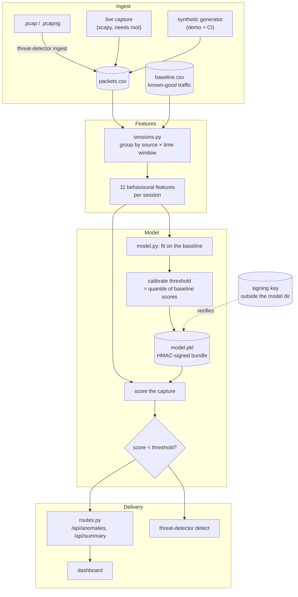
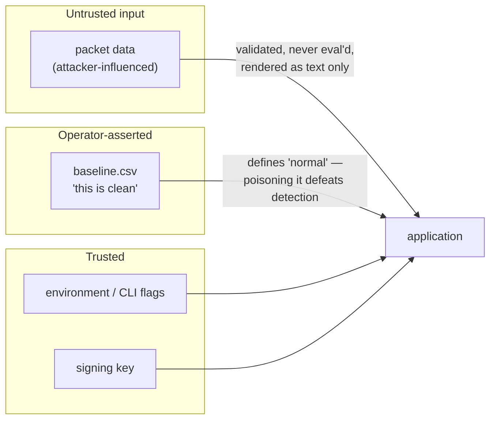

# Architecture

## What this is meant to do

Given a capture of network traffic, find the hosts behaving in ways that do not
match how the network normally behaves, and rank them so a person can look at
the top of the list first.

That sentence contains the three commitments the design is accountable to:

1. **Behaviour, not packets.** The unit of judgement is a host over a period of
   time, because that is the smallest thing an attack is visible in.
2. **Compared against normal.** "Normal" is learned from a capture you assert is
   clean, not from the traffic under suspicion.
3. **Ranked, and quiet when there is nothing to say.** A detector that always
   emits alerts is a random number generator with extra steps.

### What it is explicitly not

Not an IDS. It does not run inline, does not block anything, has no rules, no
signatures, no threat intelligence, and cannot name what it found. It reads a
CSV after the fact and says "this host looks unlike the others". Treat its
output as a queue of things to look at, never as a verdict.

## The shape of the system



## Why sessions and not packets

A single packet carries almost no evidence. A port-scan packet is a small TCP
packet; so is an ACK. Scanning, sweeping, beaconing and exfiltration are
*patterns across packets*, and scoring one packet at a time destroys exactly the
structure that identifies them.

| Feature | What it exposes |
|---|---|
| `packets`, `bytes_total` | bulk transfer, exfiltration |
| `mean_length`, `std_length` | uniform payload sizes — a machine-generated tell |
| `distinct_dst_ips` | host sweeps, lateral movement |
| `distinct_dst_ports` | port scans |
| `distinct_protocols` | protocol hopping |
| `mean_interarrival`, `std_interarrival` | beaconing — near-zero deviation is a timer, not a person |
| `small_packet_ratio` | scan and probe traffic |
| `external_dst_ratio` | traffic leaving RFC1918 space |

Measured on a capture with four planted attacks, each built so no individual
packet is unusual:

| | per-packet | per-session |
|---|---|---|
| Attacks found | 2 of 4, never the port scan | **4 of 4, in 300 of 300 trials** |
| Alerts to review | 346 | **~5** |
| False alarms on separate clean traffic | — | **1.3%** |

## Why it fits on a baseline

Fitting on the capture under inspection teaches the model that whatever attack
is in there is part of normal. It also anchors the score distribution to the
attacker, which is why a fixed threshold cannot work: when this was measured,
clean traffic's own worst session scored **−0.167** while the worst attack
scored **−0.124**. There was no number between them. Scores are only comparable
within one fitted model, so the threshold is calibrated per model, against the
baseline.

```mermaid
sequenceDiagram
    participant O as Operator
    participant T as train
    participant D as detect
    O->>T: baseline.csv (asserted clean)
    T->>T: split into 5 folds; score each fold<br/>with a model fitted on the other four
    T->>T: threshold = quantile(out-of-fold scores, q)
    T->>T: fit the final model on all of it
    T-->>O: signed bundle with its threshold
    O->>D: packets.csv (under suspicion)
    D->>D: score with the final model
    D-->>O: sessions below the threshold, worst first
```

Without a baseline there is nothing to calibrate against, so the app falls back
to flagging a fixed 2% of the inspected traffic and logs a warning. A quota is
not detection — it is an alert budget — and on the reference data it found
about half the attacks. It exists only so a first run does something.

## Choosing the detector: novelty, not outlier, detection

These are different problems, and the project spent two releases solving the
wrong one.

- **Outlier detection** fits on data that contains the anomalies and asks which
  points are odd. IsolationForest is good at it. LOF is weak at it in one
  specific way: a tight cluster of anomalies looks locally *dense*, and density
  is what LOF measures.
- **Novelty detection** fits on data asserted to be clean and asks how far new
  points are from it. That is what this application does as soon as a baseline
  is supplied.

The first benchmark (`scripts/benchmark_models.py`) fitted on contaminated
data, so it answered the outlier question, and IsolationForest won. Under the
novelty question the result reverses, for a reason that is easy to miss:
**IsolationForest scores do not extrapolate.** A point beyond the training
range is isolated by the first split on that feature, exactly like a point *at*
the edge of the range. So a session moving 560 KB, against a baseline topping
out near 70 KB, scored like the baseline's largest ordinary host. LOF's score is
a ratio of distances, and keeps growing as a session moves away.

Measured on identical trials — capture and baseline recorded independently,
both detectors with the coverage filter described below:

| detector | all four attacks found | worst trial |
|---|---|---|
| IsolationForest | 695/700 | 2 of 4 |
| **LOF** | **700/700** | 4 of 4 |

Without the coverage filter, IsolationForest once missed all four.

Packet mode keeps IsolationForest, because packet mode exists to reproduce the
original design and its documented figures.

## Calibration: four traps, all found the same way

Each of these passed every unit test. Each was found by generating hundreds of
captures with independent recording times and looking at the ones that failed.

**1. The threshold was set by an artifact.** Calibrating at the minimum
baseline score makes the bar hostage to the weirdest session there. That was a
one-packet window at a capture boundary. `MIN_SESSION_PACKETS` (default 3)
drops windows too small to describe behaviour.

**2. Windows followed the wall clock.** Sessions were cut at clock boundaries
(:00, :05, …), so a capture starting at 03:54:58 got a two-second first window
whose sliver sessions set the threshold — and the same traffic recorded a
minute later analysed correctly. **Results depended on the time of day.**
Windows are now anchored at each capture's first packet.

**3. The last window could still be a sliver.** Anchoring fixes the start, not
the end. Three packets in one final second — zero inter-arrival gaps, almost no
volume — looked like the most anomalous thing in the baseline and hid all four
attacks. `MIN_WINDOW_COVERAGE` (default 0.5) drops sessions from a window the
capture spans for under half its length.

**4. The threshold was measured in-sample.** Scoring a novelty model against
its own training data is biased toward "normal": every training point is its
own nearest neighbour. A threshold set on those flattering scores was too
tight, and on separate clean captures ordinary hosts crossed it — 17 false
alarms out of 50 sessions in the worst case. The threshold is now set on
**out-of-fold** scores, which cut the false-alarm rate from 1.9% to 1.5% and the
worst case from 17 to 9.

That last one also invalidated a claim this document used to make. Earlier
versions reported false alarms by scoring the model against the baseline it
was trained on, and so understated them. Every false-alarm figure here is now
measured on a separate clean capture.

### The operating point

`q` is where the threshold sits among out-of-fold baseline scores. With LOF
and out-of-fold calibration, `q = 0.0` is the best measured setting: all four
attacks in 200 of 200 trials, a 1.5% false-alarm rate. Under IsolationForest the
trade-off had run the other way — its saturated scores put attacks barely past
the baseline's edge, so the strictest threshold cost recall. That no longer
holds.

### The lesson that keeps recurring

**Any statistic taken at the extreme of a small sample is set by its worst
artifact** — and an extreme measured on the data that produced it is
optimistic. Traps 1, 3 and 4 are all instances. Expect a fifth.

## Module map

| Module | Responsibility | Depends on |
|---|---|---|
| `config.py` | every setting, all from env, validated at construction | — |
| `features.py` | CSV loading, validation, per-packet features | config |
| `sessions.py` | per-source windowed behavioural features | features |
| `model.py` | fit, calibrate, score, summarise, cache | features, sessions, integrity |
| `integrity.py` | sign and verify the model before unpickling | — |
| `jobs.py` | background training, state on disk | config |
| `auth.py` | host check, CSRF, token, response headers | config |
| `routes.py` | HTTP only; no logic | model, jobs |
| `cli.py` | the operator-facing surface | everything |
| `synth.py`, `pcap.py` | getting data in | config |
| `selfcheck.py` | proves detection still works; runs in CI | model, synth |

The rule the layering enforces: **`routes.py` contains no decisions.** Anything
it does, the CLI must be able to do too, which is what keeps the tool usable
without a browser.

## Threat model

Who this is defending against, and what is out of scope.

| Asset | Threat | Control |
|---|---|---|
| The model file | Attacker writes a malicious pickle; `joblib.load` executes it | HMAC-SHA256 over the payload, verified **before** unpickling; key lives outside the model directory |
| The analysis | Anyone who can reach the port reads the network's traffic profile | `API_TOKEN` on `/api/*`; `serve` refuses a non-loopback bind without one |
| The service | A website the operator visits POSTs to `127.0.0.1` | Custom header required on state-changing requests, forcing a CORS preflight |
| The service | DNS rebinding points a hostile domain at the port | `Host` header allowlist |
| The operator's browser | Injected content from packet data executing as script | CSP; all rendering via `textContent` / `createElementNS` |
| Availability | Training request never returns; overlapping runs corrupt the model | Background jobs, single-flight, atomic model replace |

**Out of scope, stated plainly.** A poisoned baseline — if the attacker is
already in the traffic you fit on, they are normal by definition. An operator
who sets `ALLOWED_HOSTS=*` and `API_TOKEN` empty on a routable interface. The
capture pipeline itself: this tool trusts the CSV it is given.

## Data and trust boundaries



Packet fields reach the browser and the terminal, so they are treated as hostile
text everywhere: no `innerHTML`, no shell interpolation, no `eval`. The baseline
is the weakest link by design — it is an assertion the operator makes, and the
system cannot check it.

## Performance envelope

Honest limits, since they decide whether this fits a given job:

- The capture is loaded into memory as a DataFrame. Roughly 1 GB of RAM per
  ~10 million packet rows; beyond that, split the capture by time.
- Session aggregation is `O(packets)` and fully vectorised. Measured: 100k
  packets aggregate in ~0.5s; end to end, 1M packets train in ~6s and 2M
  (60,000 sessions) in ~12s. LOF costs within ~15% of IsolationForest — CSV
  parsing dominates, not the model.
- Calibration fits five extra models (one per fold), which is cheap next to
  parsing at every size measured.
- Scoring is memoised on `(model, capture)` file fingerprints, so the dashboard's
  two endpoints share one pass instead of scoring the capture twice per click.
- Training runs on a worker thread with state on disk, so it survives an HTTP
  timeout and is visible to every worker under gunicorn.
